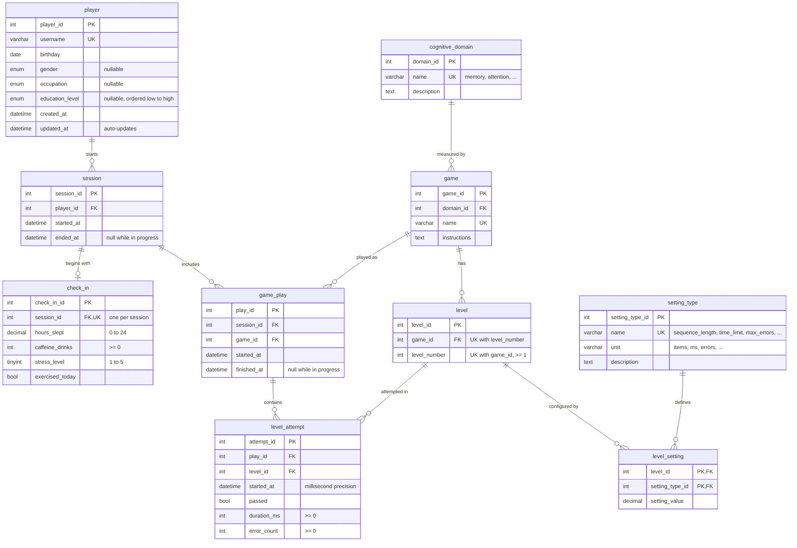

# Schema

The `brain_arcade` MySQL database, as defined in [backend/database/schema.sql](backend/database/schema.sql). Ten tables in 3NF (and BCNF), five views, four triggers, two functions and one stored procedure.

> Keep this file in sync with `schema.sql`. GitHub and VS Code (with a Mermaid extension) render the diagram below.

## Relationships

| Parent → child | Cardinality | On parent delete |
|---|---|---|
| player → session | 1 to 0..N | cascade |
| session → check_in | 1 to 0..1 | cascade |
| session → game_play | 1 to 0..N | cascade |
| cognitive_domain → game | 1 to 0..N | restrict |
| game → level | 1 to 0..N | restrict |
| game → game_play | 1 to 0..N | restrict |
| game_play → level_attempt | 1 to 0..N | cascade |
| level → level_attempt | 1 to 0..N | restrict |
| level → level_setting | 1 to 0..N | cascade |
| setting_type → level_setting | 1 to 0..N | restrict |

Data a player generates (sessions, check-ins, plays, attempts) is deleted with the player. Catalog rows (domains, games, levels, setting types) can't be deleted while anything references them.

## Constraints

- **Unique:** `player.username`, `cognitive_domain.name`, `game.name`, `setting_type.name`, `check_in.session_id`, `level (game_id, level_number)`.
- **Checks:**
  - `ended_at >= started_at` on `session`, and `finished_at >= started_at` on `game_play`;
  - `check_in`: `hours_slept` 0–24, `caffeine_drinks` ≥ 0, `stress_level` 1–5;
  - `level.level_number` ≥ 1;
  - `level_attempt`: `duration_ms` and `error_count` ≥ 0.
- **Index:** `level_attempt (play_id, started_at)`, for listing a play's attempts in order.

## Design notes

- **Level difficulty and pass rules live in `level_setting`.** Each level's `sequence_length`, `time_limit`, `max_errors` and so on are rows, not columns, so new kinds of settings need no schema change.
- **`level_attempt.passed` is stored, not derived.** It's the outcome judged against the level's settings at play time, so changing a level's settings later doesn't rewrite history.
- **`player.education_level` is an ordered ENUM.** Its values run from `less_than_high_school` to `doctorate`, so `education_level + 0` (the ENUM index, 1-7) supports range filters such as "bachelor's or higher". Add new values in rank order, not at the end. `occupation` is a plain ENUM with no order.
- **`game_play` has no `player_id`.** The player is reached through `session`; storing it again would break 3NF.

## Views

| View | One row per | Columns |
|---|---|---|
| `game_play_score` | game play | `play_id, session_id, game_id, score`: the highest `level_number` passed, or 0. Computed, never stored. |
| `player_profile` | player | `player_id, gender, occupation, education_level, age, age_group` (e.g. `30-39`, by current age) |
| `finished_play` | finished game play | `player_id, play_id, session_id, game_id, started_at, score, completion` (`score` / the game's top level, 0-1, so different games can be averaged together) |
| `level_rule` | level | `level_id, time_limit_ms, max_errors`, pivoted out of `level_setting` |
| `check_in_factor` | check-in and factor | `session_id, factor, bucket, bucket_order`, e.g. `sleep / under_6h / 1`. Factors are `sleep`, `caffeine`, `stress` and `exercise`. |

## Functions and procedures (cohort stats)

- **`in_period(t, start, end)`** returns TRUE if `t` is in `[start, end)`. A NULL bound means that side is open.
- **`profile_attribute(player_id, attribute)`** returns one of the player's `age_group`, `gender`, `occupation` or `education_level`, chosen by name, or `'unspecified'`.
- **`load_cohort(player_id, game_id, start, end, gender, occupation, education_level, education_min, education_max, age_min, age_max, match, min_plays)`** picks the players to compare a player with, and fills three temporary tables that only the current connection can see:
  - `cohort_member (player_id, is_me)`: the player, plus everyone who passes every active filter. A NULL filter (or `''` for `match`) is switched off.
  - `cohort_play`: members' finished plays in the period, on games the player played then. Same columns as `finished_play`, plus `is_me`.
  - `cohort_player_game (player_id, game_id, is_me, plays, avg_score, best_score)`: members with fewer than `min_plays` plays of a game are dropped from that game.

  The `stats_store/sql/` cohort queries (`cohort_comparison`, `cohort_distribution`, `demographic_breakdown`, `learning_curve`, `condition_impact` and `level_performance`) read these tables, so `StatsStore` calls `load_cohort` first on the same connection. MySQL can't open a temporary table twice in one query, so each of those queries reads each temporary table only once.

## Triggers

A level attempt's level must belong to the same game as its game play:

| Trigger | Table / event | Rejects |
|---|---|---|
| `trg_level_attempt_same_game_insert` | `level_attempt` BEFORE INSERT | a level from a different game than the play |
| `trg_level_attempt_same_game_update` | `level_attempt` BEFORE UPDATE | the same, on update |
| `trg_game_play_game_locked` | `game_play` BEFORE UPDATE | changing `game_id` once the play has attempts |
| `trg_level_game_locked` | `level` BEFORE UPDATE | changing `game_id` once the level has attempts |

The last two stop the rule being broken after the fact by moving a play or level to another game.
