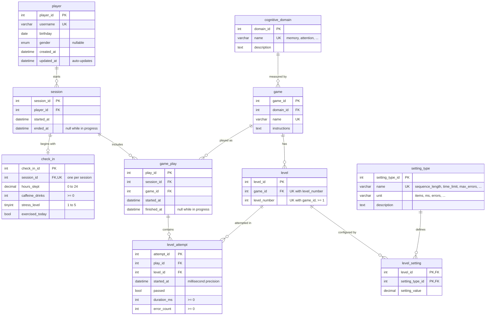

# Schema

The `brain_arcade` MySQL database, as defined in [backend/database/schema.sql](backend/database/schema.sql). Ten tables in 3NF (and BCNF), one view, four triggers.

> Keep this file in sync with `schema.sql`. GitHub and VS Code (with a Mermaid extension) render the diagram below.

## Relationships

| Parent → child | Cardinality | On parent delete |
|---|---|---|
| player → session | 1 to 0..N | cascade |
| session → check_in | 1 to 0..1 | cascade |
| session → game_play | 1 to 0..N | cascade |
| cognitive_domain → game | 1 to 0..N | restrict |
| game → level | 1 to 0..N | restrict |
| game → game_play | 1 to 0..N | restrict |
| game_play → level_attempt | 1 to 0..N | cascade |
| level → level_attempt | 1 to 0..N | restrict |
| level → level_setting | 1 to 0..N | cascade |
| setting_type → level_setting | 1 to 0..N | restrict |

Data a player generates (sessions, check-ins, plays, attempts) is deleted with the player. Catalog rows (domains, games, levels, setting types) can't be deleted while anything references them.

## Constraints

- **Unique:** `player.username`, `cognitive_domain.name`, `game.name`, `setting_type.name`, `check_in.session_id`, `level (game_id, level_number)`.
- **Checks:**
  - `ended_at >= started_at` on `session`, and `finished_at >= started_at` on `game_play`;
  - `check_in`: `hours_slept` 0–24, `caffeine_drinks` ≥ 0, `stress_level` 1–5;
  - `level.level_number` ≥ 1;
  - `level_attempt`: `duration_ms` and `error_count` ≥ 0.
- **Index:** `level_attempt (play_id, started_at)`, for listing a play's attempts in order.

## Design notes

- **Level difficulty and pass rules live in `level_setting`.** Each level's `sequence_length`, `time_limit`, `max_errors` and so on are rows, not columns, so new kinds of settings need no schema change.
- **`level_attempt.passed` is stored, not derived.** It's the outcome judged against the level's settings at play time, so changing a level's settings later doesn't rewrite history.
- **`game_play` has no `player_id`.** The player is reached through `session`; storing it again would break 3NF.
- **Abandoned sessions are tidied when the player starts a new one.** A session that is still open after 2 hours with no activity (it starting, or a play starting or finishing) is ended at its last activity if it has a check-in or a finished play, and deleted otherwise. This is done in `SessionHandler.start_session`; there is no schema change.

## View: `game_play_score`

One row per game play: `play_id, session_id, game_id, score`. The score is the highest `level_number` passed in that play, or 0 if none was passed. It's computed, never stored.

## Triggers

A level attempt's level must belong to the same game as its game play:

| Trigger | Table / event | Rejects |
|---|---|---|
| `trg_level_attempt_same_game_insert` | `level_attempt` BEFORE INSERT | a level from a different game than the play |
| `trg_level_attempt_same_game_update` | `level_attempt` BEFORE UPDATE | the same, on update |
| `trg_game_play_game_locked` | `game_play` BEFORE UPDATE | changing `game_id` once the play has attempts |
| `trg_level_game_locked` | `level` BEFORE UPDATE | changing `game_id` once the level has attempts |

The last two stop the rule being broken after the fact by moving a play or level to another game.
